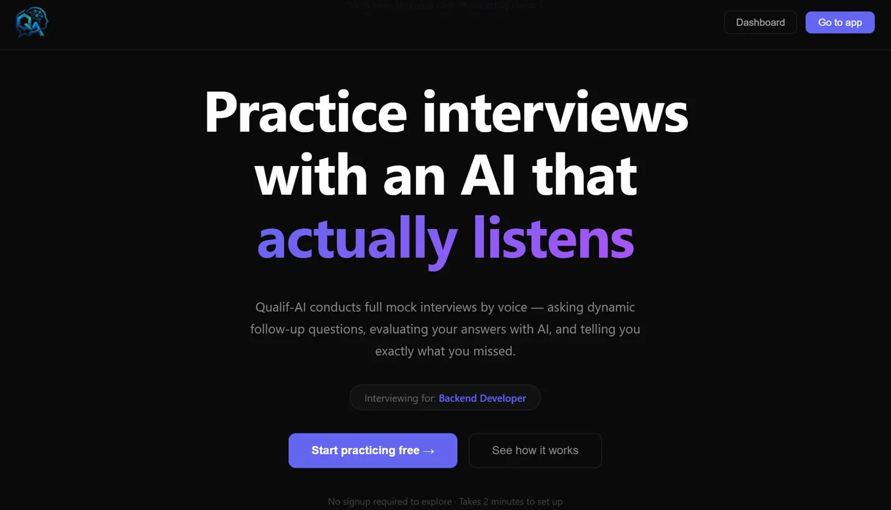
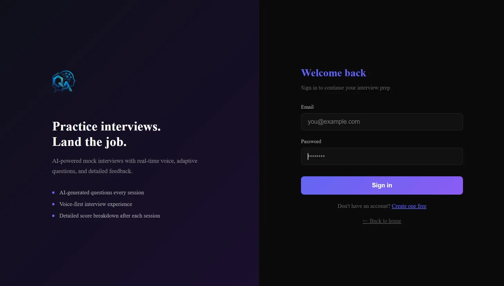

# Qualif-AI — AI Interview Simulator

> **Practice interviews with an AI that actually listens.**

Qualif-AI is a full-stack voice-first mock interview simulator. Speak your answers aloud, get evaluated by AI, and track your progress over time — with a skill graph that shows exactly what to work on next.

**Live:** [qualif-smart-ai.vercel.app](https://qualif-smart-ai.vercel.app)

---

## Screenshots

| Landing | Login |
|---|---|
|  |  |

> Add more screenshots to `docs/screenshots/` — interview screen, dashboard, skill graph, session detail.

---

## What Makes It Different

Most mock interview tools give you a list of questions and a text box. Qualif-AI conducts an actual interview:

- **Speaks the question aloud** using browser TTS — you respond by voice
- **Asks follow-up questions** based on what you said, not a fixed script
- **Resume-aware** — upload your CV and the Complete Interview asks about your specific projects and experience
- **Hybrid scoring** — every answer is scored by both Groq LLM and a deterministic layer (keyword matching, answer structure, depth detection) for consistent, explainable results
- **Skill graph** — mastery per skill updates after every session, and the next question targets your weakest area

---

## Features

### Two Interview Modes
- **Quick Practice** — 8 adaptive technical questions, follow-ups every other question, no resume needed
- **Complete Interview** — structured 4-phase flow: Introduction → Resume Review → Technical → Behavioural

### Voice-First Experience
- Browser Web Speech API for both STT and TTS — zero setup, works on Chrome/Edge
- Switch to typed input at any time
- WPM tracking, filler word detection

### AI Evaluation
- Single Groq batch call evaluates all answers at once (~5–8s for 8 answers)
- Phase-aware scoring rubrics — intro scored on communication, technical on accuracy, behavioural on STAR format
- STT error correction built into evaluation prompt

### Hybrid Scoring Engine
- LLM score (Llama 3.3 70B) blended with deterministic signals
- Keyword bank per topic — checks for expected technical terms
- Structure detection — intro / explanation / conclusion patterns
- Depth penalty — penalises genuinely thin or vague answers
- Blend ratios are phase-aware: LLM carries 72–80% weight, deterministic 20–28%

### Answer Benchmarking
- Ideal answer generated once per question by Groq, cached in MongoDB
- Your answer compared against ideal: covered concepts ✓, missing ✗, extras +
- Similarity score, improvement tip, common mistakes

### Skill Graph
- 35+ skills across 7 categories: Data Structures, Algorithms, System Design, Languages, Concepts, Communication, Behavioural
- Exponentially weighted mastery (recent sessions weighted more)
- Adaptive targeting — next question targets weakest unpractised skill
- Dashboard shows category breakdown, weakest areas, next target

### Dashboard
- Score trend chart across sessions
- Weak areas — concepts most frequently missed
- Performance by topic
- Per-session detail with collapsible answer breakdown

---

## Tech Stack

| Layer | Technology |
|---|---|
| Frontend | React 18 + Vite, deployed on Vercel |
| Backend | FastAPI (Python 3.11), deployed on Render |
| Database | MongoDB Atlas (M0 free tier) |
| AI | Groq API — Llama 3.1 8B (fast) + Llama 3.3 70B (smart) |
| Voice | Browser Web Speech API (SpeechRecognition + SpeechSynthesis) |
| Auth | JWT (PyJWT) + bcrypt |

---

## Architecture

```
┌─────────────────┐     HTTPS      ┌─────────────────────────┐
│   React (Vite)  │ ─────────────► │   FastAPI (Python 3.11) │
│   Vercel        │                │   Render                │
└─────────────────┘                └────────────┬────────────┘
                                                │
                              ┌─────────────────┼─────────────────┐
                              │                 │                 │
                    ┌─────────▼──────┐  ┌───────▼──────┐  ┌──────▼──────┐
                    │  MongoDB Atlas │  │  Groq API    │  │  Hybrid     │
                    │  Sessions      │  │  Llama 3.1/  │  │  Evaluator  │
                    │  Users         │  │  Llama 3.3   │  │  (local)    │
                    │  Skill Graphs  │  └──────────────┘  └─────────────┘
                    │  Ideal Answers │
                    └────────────────┘
```

### Key Architecture Decisions

**Batch evaluation** — all answers evaluated in a single Groq API call at the end of the interview (~5–8s). Original per-answer evaluation took ~60s total with 8 sequential calls.

**Hybrid scoring** — pure LLM scoring is fast but inconsistent. The deterministic layer adds stability: the same answer always produces the same keyword score regardless of LLM variance.

**Ideal answer caching** — ideal answers are generated once per question (fingerprinted by question + role + difficulty) and cached in MongoDB. Repeat sessions hit the cache with no API call.

**Browser TTS/STT** — tried MeloTTS and Coqui TTS. Browser Web Speech API: zero setup, works everywhere Chrome/Edge supports it. Groq corrects obvious STT errors during evaluation.

---

## Project Structure

```
qualif-ai/
├── backend/
│   ├── main.py                  # FastAPI entry, CORS, router registration
│   ├── config.py                # Pydantic settings, reads .env
│   ├── database.py              # Motor async MongoDB connection + indexes
│   ├── routers/
│   │   ├── auth.py              # register, login, /me — JWT
│   │   ├── interview.py         # start, submit-answer, next-question, evaluate, end
│   │   ├── dashboard.py         # sessions, stats, insights, skill graph, reset
│   │   └── resume.py            # PDF upload → Groq parse → store on user
│   ├── services/
│   │   ├── groq_service.py      # ask_groq(), batch_evaluate()
│   │   ├── hybrid_evaluator.py  # keyword scoring, structure detection, blend
│   │   ├── skill_graph.py       # SkillNode, SkillGraph, mastery, adaptive targeting
│   │   ├── answer_benchmark.py  # ideal answer generation + comparison
│   │   ├── question_engine.py   # generate_question(), adaptive wrapper
│   │   ├── resume_parser.py     # PyMuPDF extraction + Groq structured parse
│   │   ├── auth_service.py      # hash_password, create_token, decode_token
│   │   └── dependencies.py      # get_current_user FastAPI dependency
│   └── tests/
│       ├── conftest.py
│       ├── test_hybrid_evaluator.py   # 60+ unit tests
│       └── test_skill_graph.py        # 40+ unit tests
├── frontend/
│   └── src/
│       ├── pages/
│       │   ├── Landing.jsx
│       │   ├── Login.jsx
│       │   ├── Register.jsx
│       │   ├── Setup.jsx
│       │   ├── Interview.jsx    # State machine, voice flow, TTS/STT
│       │   └── Dashboard.jsx    # Charts, skill graph, session detail
│       ├── hooks/
│       │   ├── useSpeechRecognition.js
│       │   └── useSpeechSynthesis.js
│       └── services/
│           └── api.js           # Axios client, retry on cold start
└── README.md
```

---

## Local Setup

### Prerequisites
- Python 3.11+
- Node.js 18+
- MongoDB Atlas account (free M0 tier)
- Groq API key (free tier: 14,400 req/day)

### Backend

```bash
cd backend
python -m venv venv
source venv/bin/activate        # Windows: venv\Scripts\activate
pip install -r requirements.txt
python -m spacy download en_core_web_sm
```

Create `backend/.env`:
```env
MONGO_URI=mongodb+srv://...
DB_NAME=qualifai
JWT_SECRET=your_random_32_plus_char_string_here
JWT_EXPIRE_HOURS=24
GROQ_API_KEY=gsk_...
GROQ_FAST_MODEL=llama-3.1-8b-instant
GROQ_SMART_MODEL=llama-3.3-70b-versatile
FRONTEND_URL=http://localhost:5173
```

```bash
uvicorn main:app --reload
# API running at http://localhost:8000
```

### Frontend

```bash
cd frontend
npm install
```

Create `frontend/.env`:
```env
VITE_API_URL=http://localhost:8000
```

```bash
npm run dev
# App running at http://localhost:5173
```

### Tests

```bash
cd backend
pip install pytest
pytest
# 103 passed
```

---

## Deployment

| Service | What | URL |
|---|---|---|
| Vercel | Frontend | qualif-smart-ai.vercel.app |
| Render | Backend | qualifai-backend.onrender.com |
| MongoDB Atlas | Database | M0 free cluster |

**Render build command:**
```
pip install -r requirements.txt && python -m spacy download en_core_web_sm
```

**Render start command:**
```
python -m uvicorn main:app --host 0.0.0.0 --port $PORT
```

Python version pinned in `backend/runtime.txt`: `python-3.11.9`

---

## Environment Variables

### Backend (Render)
| Variable | Description |
|---|---|
| `MONGO_URI` | MongoDB Atlas SRV connection string |
| `DB_NAME` | Database name (`qualifai`) |
| `JWT_SECRET` | Random string, 32+ characters |
| `JWT_EXPIRE_HOURS` | Token expiry (`24`) |
| `GROQ_API_KEY` | Groq API key (`gsk_...`) |
| `GROQ_FAST_MODEL` | `llama-3.1-8b-instant` |
| `GROQ_SMART_MODEL` | `llama-3.3-70b-versatile` |
| `FRONTEND_URL` | Vercel deployment URL |

### Frontend (Vercel)
| Variable | Description |
|---|---|
| `VITE_API_URL` | Render backend URL |

---

## Known Limitations

- **Browser STT only** — no Whisper integration. Technical terms sometimes misrecognised; Groq corrects obvious errors during evaluation.
- **Render cold start** — free tier sleeps after 15 min idle (~30s wake). Mitigated with UptimeRobot pinging `/health` every 5 minutes.
- **Groq free tier** — 14,400 requests/day. Sufficient for personal use and portfolio demos.
- **Voice requires Chrome/Edge** — Firefox does not support Web Speech API.

---

## Author

**Prakhar Sharma**
GitHub: [@theprakhar211](https://github.com/theprakhar211)

---

## License

MIT
